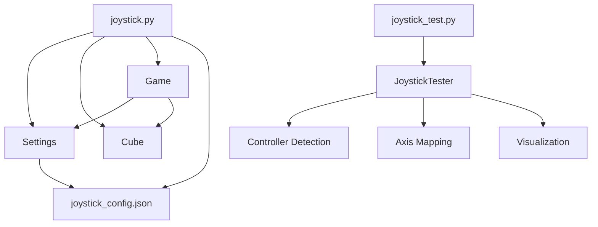
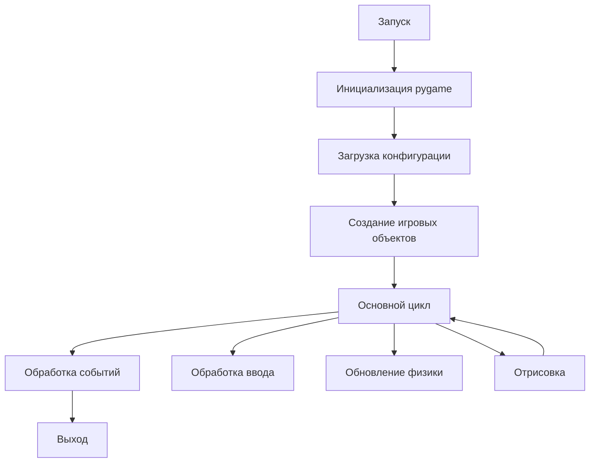
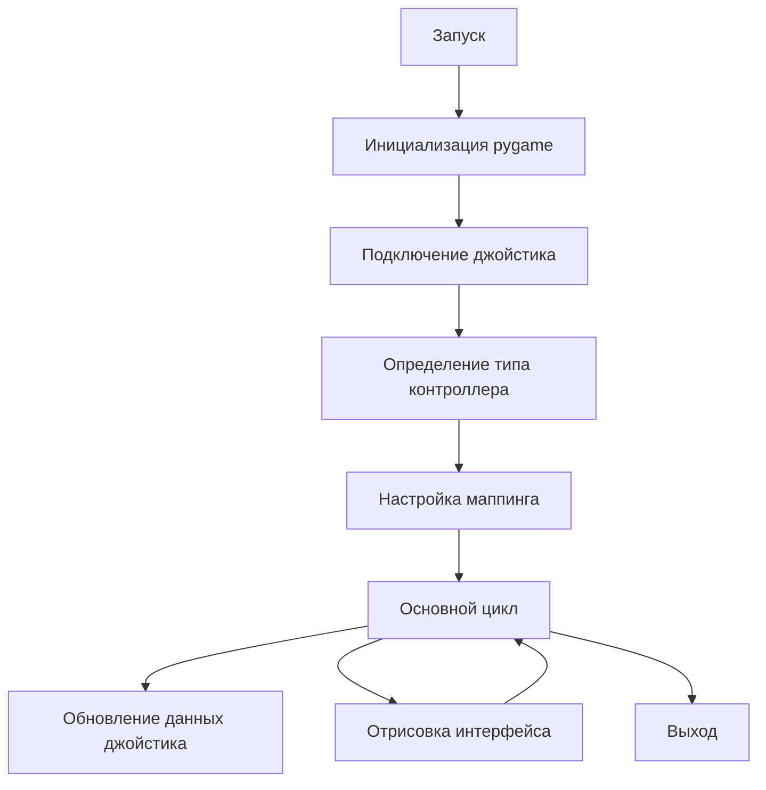
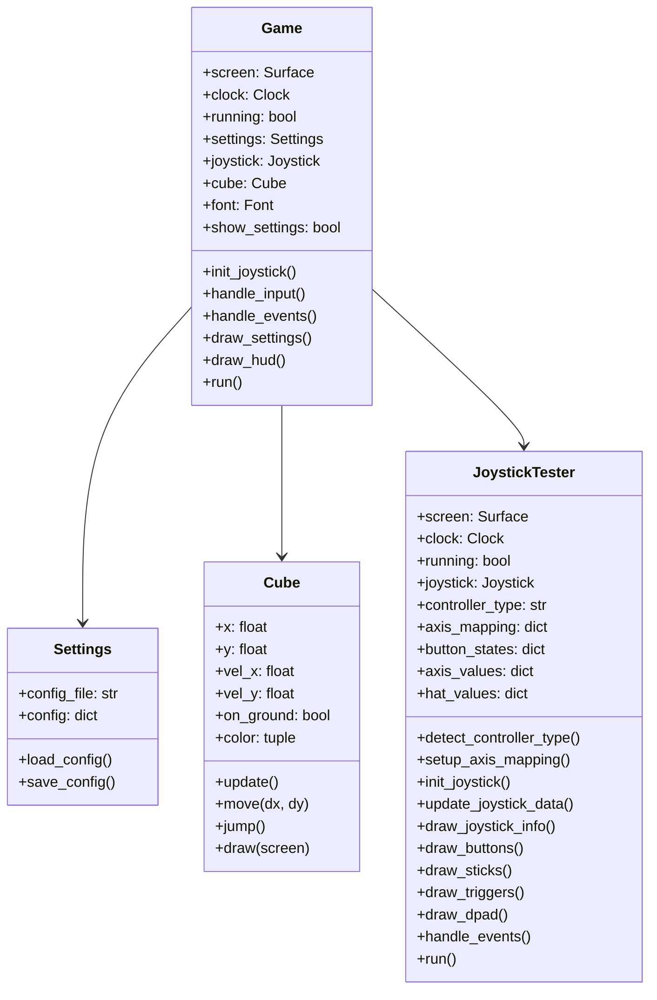

# Проект "Джойстик Тестер и Игра"

## 📋 Содержание

1. [Структура проекта](#-структура-проекта)
2. [Описание файлов](#-описание-файлов)
3. [Архитектура проекта](#-архитектура-проекта)
4. [Библиотеки/фреймворки](#-библиотекифреймворки)
5. [Точка входа и запуск](#-точка-входа-и-запуск)
6. [Архитектурные особенности](#-архитектурные-особенности)

## 📁 Структура проекта

```
2/
├── joystick.py              # Основная игра с кубиком
├── joystick_test.py         # Тестер джойстика
├── joystick_config.json     # Конфигурационный файл (создается автоматически)
└── README.md               # Документация проекта
```

## 📄 Описание файлов

### `joystick.py` - Основная игра

**Назначение:** 2D платформер с поддержкой джойстика и клавиатуры.

**Ключевые классы:**
- `Settings` - управление конфигурацией
- `Cube` - игровой объект (кубик)
- `Game` - основной игровой цикл

**Связи с другими файлами:**
- Читает/записывает `joystick_config.json`
- Независим от `joystick_test.py`

**Логика:**
1. Инициализация pygame и джойстика
2. Загрузка конфигурации
3. Создание игрового объекта
4. Основной цикл: обработка ввода → обновление → отрисовка

### `joystick_test.py` - Тестер джойстика

**Назначение:** Диагностическое приложение для тестирования джойстиков.

**Ключевые классы:**
- `JoystickTester` - основной класс тестера

**Связи с другими файлами:**
- Полностью независим
- Не использует внешние конфигурации

**Логика:**
1. Автоопределение типа контроллера (Xbox/PlayStation/Nintendo/Generic)
2. Настройка маппинга осей
3. Визуализация всех элементов джойстика в реальном времени

### `joystick_config.json` - Конфигурация

**Назначение:** Хранение настроек управления.

**Содержимое:**
```json
{
    "joystick_enabled": true,
    "joystick_id": 0,
    "dead_zone": 0.1,
    "keyboard_controls": {
        "up": 119,      // W
        "down": 115,    // S
        "left": 97,     // A
        "right": 100,   // D
        "jump": 32      // SPACE
    },
    "joystick_controls": {
        "jump_button": 0,
        "axis_x": 0,
        "axis_y": 1
    }
}
```

## 🏗️ Архитектура проекта

### Общая структура

Проект состоит из двух независимых приложений:



### Потоки данных

#### Игра (joystick.py)


#### Тестер (joystick_test.py)


### Архитектурная схема классов



## 📚 Библиотеки/фреймворки

### Pygame
**Назначение:** Основная библиотека для создания 2D игр и мультимедийных приложений.

**Где используется:**
- `joystick.py`: создание окна, обработка событий, отрисовка
- `joystick_test.py`: создание интерфейса, работа с джойстиком

**Ключевые модули:**
- `pygame.display` - управление окном
- `pygame.event` - обработка событий
- `pygame.joystick` - работа с джойстиками
- `pygame.draw` - отрисовка примитивов
- `pygame.font` - работа с текстом

### Стандартные библиотеки Python
- `json` - работа с конфигурационными файлами
- `os` - проверка существования файлов
- `math` - математические вычисления
- `sys` - системные функции

## 🚀 Точка входа и запуск

### Запуск игры
```bash
python joystick.py
```

**Что выполняется первым:**
1. Инициализация pygame
2. Создание экземпляра класса `Game`
3. Загрузка конфигурации из `joystick_config.json`
4. Подключение джойстика
5. Запуск основного игрового цикла

### Запуск тестера
```bash
python joystick_test.py
```

**Что выполняется первым:**
1. Инициализация pygame
2. Создание экземпляра класса `JoystickTester`
3. Автоопределение подключенного джойстика
4. Настройка маппинга осей
5. Запуск цикла визуализации

## 🎯 Архитектурные особенности

### Нестандартные решения

1. **Автоопределение типа контроллера**
   - Анализ названия джойстика для определения производителя
   - Автоматическая настройка маппинга осей
   - Поддержка Xbox, PlayStation, Nintendo и Generic контроллеров

2. **Гибкая система конфигурации**
   - JSON-файл для хранения настроек
   - Автоматическое создание конфигурации по умолчанию
   - Возможность настройки как клавиатуры, так и джойстика

3. **Визуальные эффекты в тестере**
   - Цветовая индикация нажатий кнопок
   - Эффект затухания для кнопок
   - Реальное время отображения всех элементов джойстика

### Причины выбора архитектуры

1. **Модульность**
   - Разделение игры и тестера позволяет независимую разработку
   - Каждый файл решает свою задачу

2. **Простота**
   - Один файл = одно приложение
   - Минимальные зависимости
   - Понятная структура кода

3. **Расширяемость**
   - Легко добавить новые типы контроллеров
   - Простое добавление новых настроек
   - Возможность расширения функционала

4. **Кроссплатформенность**
   - Pygame работает на Windows, macOS, Linux
   - Автоматическое определение джойстиков
   - Универсальные настройки управления

## 🎮 Управление

### Игра (joystick.py)
- **Клавиатура:** WASD - движение, Пробел - прыжок
- **Джойстик:** Левый стик - движение, Кнопка 0 - прыжок
- **F1** - открыть/закрыть настройки
- **ESC** - выход

### Тестер (joystick_test.py)
- **ESC** - выход
- Автоматическое отображение всех элементов джойстика

---

Автор: legenda  
Telegram: [@LEGENDA_SD](https://t.me/LEGENDA_SD)
